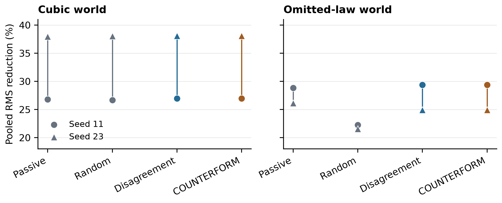
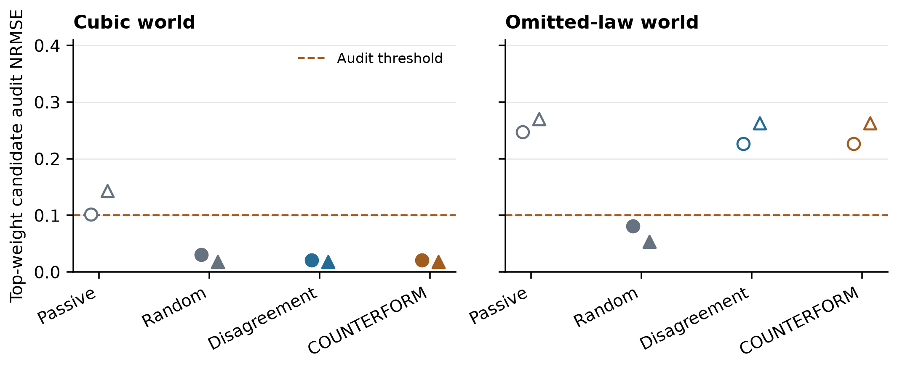
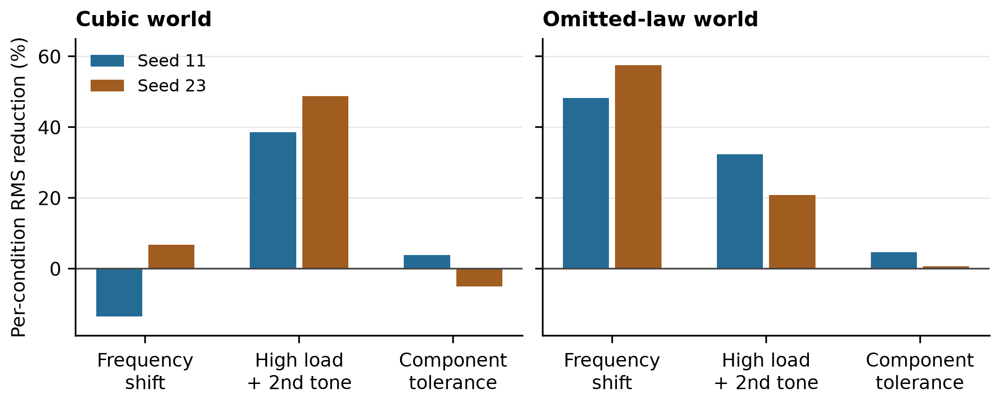

# COUNTERFORM A Synthetic Pilot Study of Experiment Selection and Model Adequacy

**kai9987kai**

2 November 2026

## Abstract

We present COUNTERFORM, a local computational laboratory that connects finite-family dynamical identification, experiment selection, absorber design and independent model criticism. A forced oscillator supplies synthetic position, velocity, acceleration and force measurements. Three candidate laws are fitted before a tuned mass absorber is selected from a 30-entry grid. We analyse an exploratory pilot of 16 runs comprising four acquisition strategies, two worlds and two parameter seeds. One world contains cubic stiffness represented in the candidate library; the other adds friction and quadratic drag that cannot be represented jointly by any candidate. COUNTERFORM's decision-sensitive acquisition rule and a predictive-disagreement baseline select identical experiments in all four world–seed instances, producing identical fitted models, designs and outcomes. Their mean pooled RMS reductions are consequently equal: 32.51% in the cubic world and 27.14% in the omitted-law world. Selected and nominal absorbers also coincide in all 16 runs. The fixed residual audit accepts an approximate model in both omitted-law random-acquisition runs, while rejecting every acquired fit in both cubic passive runs. Eight of 48 challenge evaluations increase displacement despite positive pooled reductions in every run. These observations establish an inspectable negative pilot: the added decision weighting does not change the tested policies, and audit acceptance does not identify the true law. They do not establish general strategy equivalence, calibrated model rejection or physical engineering reliability.

**Keywords** Scientific machine learning; experiment selection; model discrepancy; tuned mass absorbers; negative results; reproducibility

## 1 Introduction

An automated design process can improve an objective while relying on an incomplete physical model. This creates two separate questions: whether an experiment changes a useful design decision, and whether the available models describe the observations well enough to support that decision. A concentrated model weight answers neither question by itself. In particular, the highest-scoring member of an inadequate library can still receive nearly all relative weight.

COUNTERFORM makes these questions executable in a small oscillator laboratory. The learner receives instrument channels rather than hidden physical coefficients. It selects a bounded number of forcing experiments, fits predetermined candidate laws and chooses an absorber. Separate data then assess residual adequacy, and nonlinear challenge simulations measure the selected design's behaviour. The design is frozen before either assessment can alter it.

The present study evaluates a decision-sensitive extension to predictive disagreement. Its motivation is that a disagreement should matter more when it affects the downstream absorber choice. The pilot also examines whether a fixed audit detects an intentionally incomplete law library. The contribution is the reproducible implementation and analysis of this restricted experiment. It is not a new general equation-discovery method, an autonomous mechanical invention result or a validation of the broader COUNTERFORM research programme.

The primary finding is policy coincidence. Adding decision weighting changes neither the acquired experiments nor their engineering outcomes in the sampled instances. A second finding concerns model criticism: a fixed force-balance diagnostic can accept a structurally incomplete law and can reject poorly identified fits even when the correct family is available. Both findings guide the interpretation of the software rather than establish a population-level effect.

## 2 Related work

Interpretable dynamical identification has a broader scope than the finite model comparison used here. Sparse identification of nonlinear dynamics selects parsimonious combinations from a candidate-function library [1]. COUNTERFORM instead fits three fixed physical families, with known mass and directly measured acceleration. It therefore does not implement SINDy or discover unrestricted equations.

AutoSciLab combines active experimentation, learned latent representations and interpretable equation learning [2]. This supplies a relevant precedent for connecting experiments with scientific models. COUNTERFORM uses a smaller synthetic domain without latent-variable learning, neural dynamics or physical automation. It does not reproduce or benchmark AutoSciLab.

Information-based experimental design has a long statistical foundation [3]. Recent discrepancy-aware Bayesian experimental design explicitly studies how incomplete simulators affect acquisition and discrepancy learning [4]. Goal-driven Bayesian optimal experimental design further formulates acquisition around downstream robust decisions [5]. These works motivate distinguishing information, model criticism and decision quality. The scores evaluated here are finite heuristics, not expected information gain, Bayesian value of information or implementations of those methods.

The model-weight construction uses a complexity penalty inspired by Schwarz's model-selection criterion [6]. Its sampling assumptions and noisy regressors prevent us from treating the resulting weights as calibrated posterior probabilities. Robust tuned mass damper design is itself established engineering work [7]. COUNTERFORM uses an enumerated design grid and a describing-function approximation, without continuous uncertainty coverage or a global design guarantee.

## 3 Computational methods

### 3.1 Hidden dynamics and observations

The unmodified oscillator has known mass m = 1 kg and obeys

$$
m\ddot{x}+c\dot{x}+kx+\alpha x^3+f_c\tanh(\dot{x}/v_s)+q|\dot{x}|\dot{x}=u(t).
$$

The smoothing velocity is v_s = 0.04 m/s. For each seed, stiffness k is sampled uniformly from 33 to 39 N/m and viscous damping c from 0.26 to 0.40 N s/m. The cubic coefficient alpha is sampled from 180 to 260 N/m^3. The cubic world sets friction and drag to zero. The omitted-law world retains the same cubic term and adds f_c = 0.70 N and q = 3.2 N s^2/m^2. Corresponding worlds share the same sampled k, c and alpha for a given seed. Thus the four world–seed instances contain only two underlying parameter seeds.

Each acquisition applies u(t) = A sin(omega t), starts from rest and runs for 14 s. There are 421 equally spaced output samples, including the endpoints. Gaussian perturbations are independent across channels and sample times within a trial. Their standard deviations are 0.1 sigma m for position, 0.75 sigma m/s for velocity, 4 sigma m/s^2 for acceleration and max(A, 0.25) sigma N for force. Corresponding seed/trial indices reuse common random numbers across strategies and worlds; force-channel scaling can differ with excitation amplitude. The pilot uses sigma = 0.01. These scales define a synthetic sensor model rather than a calibrated physical instrument.

The learner receives only time, noisy position, velocity, acceleration and force. This is an instrumented identification task, not inference from images or numerical differentiation of position. Hidden coefficients are confined to observation generation and final evaluation. They are disclosed in completed evidence records so the analysis can inspect structural coverage.

### 3.2 Candidate fitting and relative weights

The candidate families contain linear stiffness and viscous damping; those terms plus cubic stiffness; or those terms plus smooth friction. No candidate contains the cubic and friction terms jointly, and none contains quadratic drag. Bounded linear least squares fits the measured force balance F - m a using columns x and v, with either x^3 or tanh(v/v_s) where applicable.

The bounds are 5 ≤ k ≤ 80 N/m and 0.015 ≤ c ≤ 5 N s/m. Additional coefficients satisfy 0 ≤ alpha ≤ 1500 N/m^3 or 0 ≤ f_c ≤ 3 N. Column normalisation reduces conditioning problems associated with the cubic regressor. The fitted coefficients are scored using

$$
S_h=n\log\left(\max(\mathrm{MSE}_h,10^{-16})\right)+p_h\log n.
$$

Here n is the number of acquired samples and p_h is the number of fitted coefficients. Relative weights are proportional to exp[-(S_h - min_j S_j)/2], with score differences clipped at 1400 for numerical stability. This is a BIC-style diagnostic [6]. Sensor error occurs in both the regressors and the force-balance target, so ordinary conditional-noise assumptions do not hold. Relative weights therefore describe this finite scoring rule, not confidence that the true law is present.

### 3.3 Acquisition strategies

All strategies count the same shared initial experiment, with omega = 3.4 rad/s and A = 0.35 N, toward their three-experiment budget. Passive acquisition then uses omega = 3.53 and 3.66 rad/s at the same amplitude. The other strategies choose without replacement from the Cartesian product of frequencies {3.5, 4.6, 5.7, 6.8, 8.0} rad/s and amplitudes {0.45, 1.0, 1.8} N. Random acquisition samples this menu uniformly.

For the two adaptive strategies, let a_h(e) be the approximate baseline peak displacement predicted by fitted model h for experiment e. Acquisition weights include a fixed exploration floor: w_tilde_h = 0.9 w_h + 0.1/3. With mu(e) = sum_h w_tilde_h a_h(e), predictive disagreement is

$$
D(e)=\frac{\sum_h\widetilde{w}_h\left(a_h(e)-\mu(e)\right)^2}{\max\left(\mu(e)^2,10^{-10}\right)}.
$$

COUNTERFORM augments this score with a nonnegative decision discrepancy. Let d_R be the current selected grid design and d_h the grid design preferred by model h. With a_h(d,e) denoting the predicted peak displacement with an absorber, define

$$
R_h(e)=\frac{\max\left(a_h(d_R,e)-a_h(d_h,e),0\right)}{\max\left(a_h(e),10^{-8}\right)}.
$$

COUNTERFORM maximises D(e)[0.15 + 5 sum_h w_tilde_h R_h(e)], while predictive disagreement maximises D(e). This decision discrepancy is evaluated locally at each candidate forcing condition; it is not an integrated decision-regret estimator. The finite menu, exploration floor and multiplier are implementation choices, not calibrated statistical quantities.

### 3.4 Absorber search

The absorber adds a second mass y coupled to the primary displacement x. With coupling force C and primary restoring/damping function g, the dynamics are

$$
m\ddot{x}+g(x,\dot{x})+C=u(t),\qquad m_a\ddot{y}=C.
$$

The coupling force is

$$
C=k_a(x-y)+c_a(\dot{x}-\dot{y}).
$$

The design grid has two masses {0.08, 0.16} kg, five tuning ratios {0.75, 0.9, 1.0, 1.1, 1.25} and three damping ratios {0.05, 0.15, 0.30}. The reference frequency is sqrt(sum_h w_h k_h / m). Grid stiffness and damping follow k_a = m_a(r omega_ref)^2 and c_a = 2 zeta_a m_a r omega_ref. Each strategy uses the same 30-entry recipe; physical grids can differ because their fitted reference frequencies differ.

The design approximation uses a lowest-positive-branch harmonic balance calculation. Cubic stiffness and smooth friction are represented by amplitude-dependent equivalent stiffness and damping estimated from the baseline orbit. These equivalents are reused when attaching the absorber. This approximation can miss nonlinear branches, jumps, transients and changes in the orbit caused by coupling.

Let W_h(d) be the maximum approximate displacement divided by sqrt(2) over 61 angular frequencies from 3 to 9 rad/s at 1.5 N excitation. The selected grid entry minimises

$$
J(d)=0.7\max_{h\in H_*}W_h(d)+0.3\sum_{h\in H_*}\bar{w}_hW_h(d).
$$

H_* contains models with fitted weight at least 0.025, and w_bar renormalises weights within this set. The nominal control applies the same search to the highest-weight model alone. No audit flags enter either search. There is no material-cost penalty or manufacturability objective; the mass options are simply bounded by the grid. The term robust refers only to this finite weighted/worst-model objective.

### 3.5 Independent residual audit

After both designs are frozen, two new forcing trials use (omega, A) = (4.85, 2.3) and (7.85, 0.9) in rad/s and N. They are outside the acquisition menu and are never used to refit the models, rank experiments or select the design. For model h, the audit computes

$$
E_h=\frac{\sqrt{\mathrm{mean}\left[(\widehat{g}_h(x,v)-(F-ma))^2\right]}}{\max\left(\sqrt{\mathrm{mean}\left[(F-ma)^2\right]},0.1\right)}.
$$

Both audit traces contribute to the means. A fitted candidate passes when E_h ≤ 0.08 + 2 sigma, which equals 0.10 in this pilot. A run is marked supported when any candidate passes. Otherwise every candidate is rejected and the displayed design remains exploratory. The verdict is a diagnostic label; it neither blocks simulation nor changes the selected design.

The audit conditions on measured x and v and tests force-balance residuals. It does not test a fitted model's autonomous trajectory forecast. Its threshold includes a fixed noise allowance but is not a calibrated hypothesis test or a certificate of structural correctness.

## 4 Pilot protocol and outcomes

### 4.1 Experimental units and evaluation conditions

The retained pilot uses seeds 11 and 23, cubic and omitted-law worlds, four strategies, acquisition budget three and sigma = 0.01. It contains 16 runs, four world–seed instances, and two underlying parameter seeds. The three challenge conditions within each run are deterministic evaluations of the same selected design, not additional independent experimental replicates. No pilot run is omitted from the tables.

The protocol was used during development and was not preregistered or reserved as independent confirmation. We report descriptive per-run values and paired differences. We do not fit confidence intervals, conduct significance tests or estimate a population-level strategy effect from this sample. Acquisition counts and grid recipe are matched; wall-clock work, forcing amplitudes and actual physical candidate grids are not matched.

Table 1 lists the separate nonlinear challenges. Their force is A[sin(omega t) + eta sin(1.73 omega t + 0.37)], with a secondary tone rather than an integer harmonic of omega. Primary mass remains fixed at 1 kg; changed load means changed forcing amplitude. Component factors multiply absorber mass, stiffness and damping identically for selected, nominal and oracle candidates. Challenge outcomes use the noiseless simulator trajectories, without adding sensor perturbations.

| Condition | omega rad/s | A N | eta | Absorber factors m k c |
|---|---:|---:|---:|---|
| Shifted frequency | 5.15 | 1.25 | 0.12 | 1.00 1.00 1.00 |
| High load and secondary tone | 6.55 | 2.10 | 0.22 | 1.00 1.00 1.00 |
| Component tolerance | 7.45 | 1.60 | 0.17 | 1.08 0.85 0.80 |

*Table 1. Fixed challenge settings excluded from acquisition, fitting and design ranking. The stored label High load and harmonic refers to the secondary-tone condition.*

All simulations start from rest. DOP853 integrates the declared nonlinear equations with relative tolerance 2 × 10^-8, absolute tolerance 2 × 10^-10 and maximum step 0.08 s. RMS and displacement limits use output samples from 7 to 14 s inclusive, a window of 211 samples. This finite window retains transient effects; steady-state convergence is not established.

Controls include no absorber, the nominal-fit absorber and a retrospective oracle that selects the lowest RMS grid member separately for each challenge. That oracle may choose a different design in each condition and ignores constraint feasibility, so it is a diagnostic rather than an attainable common design. The selected design is flagged when primary peak displacement exceeds 0.50 m or relative absorber stroke exceeds 0.65 m. These are illustrative numerical bounds, not validated engineering limits.

### 4.2 Aggregate performance

For challenge j, let b_j and s_j denote baseline and selected displacement RMS. The per-run headline reduction is

$$
P=100\left(1-\frac{\sqrt{\frac{1}{3}\sum_{j=1}^3s_j^2}}{\sqrt{\frac{1}{3}\sum_{j=1}^3b_j^2}}\right).
$$

This ratio of pooled RMS values is not the arithmetic mean of per-challenge percentage reductions. Table 2 then averages P across the two seeds in each world–strategy cell. Positive values indicate less displacement than the no-absorber control under the sampled challenges.

| World | Strategy | Mean P percent | Seed range percent | Supported runs |
|---|---|---:|---|---:|
| Cubic | Passive | 32.35 | 26.78 to 37.93 | 0/2 |
| Cubic | Random | 32.36 | 26.69 to 38.03 | 2/2 |
| Cubic | Disagreement | 32.51 | 26.97 to 38.05 | 2/2 |
| Cubic | COUNTERFORM | 32.51 | 26.97 to 38.05 | 2/2 |
| Omitted law | Passive | 27.49 | 26.12 to 28.85 | 0/2 |
| Omitted law | Random | 21.91 | 21.55 to 22.26 | 2/2 |
| Omitted law | Disagreement | 27.14 | 24.91 to 29.38 | 0/2 |
| Omitted law | COUNTERFORM | 27.14 | 24.91 to 29.38 | 0/2 |

*Table 2. Descriptive mean and observed seed range of pooled RMS reduction. Each row contains two runs. Support means at least one fitted candidate passed the residual diagnostic.*

*Figure 1. Individual seed values rather than uncertainty intervals. Corresponding disagreement and COUNTERFORM points coincide exactly. Lines only connect the two observed values within a strategy; they do not indicate a distribution or confidence interval.*

COUNTERFORM minus predictive disagreement is exactly 0 percentage points for each paired world–seed instance. Relative to random acquisition, its mean paired difference is +0.155 percentage points in the cubic world and +5.237 in the omitted-law world. Relative to passive acquisition, the differences are +0.160 and -0.343 percentage points respectively. These small-sample descriptive contrasts do not establish superiority. In particular, the apparent improvement over random acquisition in the omitted-law world accompanies a worse worst-challenge reduction: the mean paired worst-challenge difference is -7.011 percentage points.

### 4.3 Policy and control coincidence

The two adaptive methods acquire (3.4, 0.35), (5.7, 1.8) and (6.8, 0.45) in the cubic world, and (3.4, 0.35), (5.7, 0.45) and (6.8, 0.45) in the omitted-law world. Each sequence is shared by both seeds. Exact comparisons confirm matching raw observations, every-step weights, final models, grids, physical designs, audits and challenge outputs. Acquisition scores and textual reasons differ, so full record hashes are not expected to match.

For the selected noninitial experiments, the archived COUNTERFORM score is approximately 0.15 times the archived disagreement score. This is consistent with a zero decision-discrepancy contribution at those selected points. Unchosen candidate scores are not archived, so this observation does not establish how the multiplier behaved across the full menu. The observed null is therefore a policy-coincidence result, not a causal comparison between distinct acquired datasets.

The selected and nominal controls choose the same physical grid entry in all 16 runs; all 48 selected/nominal challenge RMS values are exactly equal. The 0.025 cutoff retains only one model in 14 runs. Cubic/passive retains two models at seed 11 and three at seed 23, but its selected grid entry still matches its nominal entry. This pilot consequently supplies no evidence of a benefit from the finite robust-design objective over nominal design.

### 4.4 Model adequacy diagnostics

Eight runs pass at least one fitted candidate and eight reject every candidate. Across all 48 fitted-candidate evaluations, 14 pass the threshold. In the omitted-law world, only random acquisition passes: the friction candidate has audit error 0.0810 at seed 11 and 0.0537 at seed 23, both below 0.10. Each candidate receives relative weight 1.0, although neither contains the true cubic and quadratic-drag terms.

These two cases are structural false acceptances if acceptance is interpreted as identifying the true law. They remain legitimate passes of the implemented finite residual criterion. The criterion was not designed or calibrated to guarantee structural identification. Conversely, both cubic/passive runs reject every fit despite containing a correct family in the library. That observation concerns the acquired parameter estimates; it is not proof that the family itself cannot explain the world.

*Figure 2. Audit error of the best-scoring candidate under the fixed residual criterion. Circles denote seed 11 and triangles seed 23. Filled markers show an any-candidate pass; hollow markers show rejection of all candidates. The dashed line is the 0.10 threshold. The two random points in the omitted-law panel pass despite absent true terms.*

### 4.5 Adverse conditions and numerical checks

All 16 pooled reductions are positive, ranging from 21.55% to 38.05%. Nevertheless, eight of 48 challenge evaluations worsen displacement. Every cubic run has one adverse challenge, and the largest increase corresponds to a reduction of -13.50%. The same instances are reused across strategies, so the count is an inventory of evaluated outcomes rather than an independent failure-rate estimate.

*Figure 3. Per-condition percentage reductions for COUNTERFORM. The selected design and challenge outputs are identical to predictive disagreement. Negative values are retained. Aggregate improvements can coexist with a worse individual condition.*

No selected-design limit is exceeded in the 48 challenge evaluations. Maximum recorded primary peak and relative absorber stroke are 0.176 m and 0.297 m, respectively. These measurements verify only the stated finite tests and illustrative limits.

For each run, a second integration with Radau checks the first selected-design challenge trajectory. The recorded relative L2 discrepancy spans 2.86 × 10^-9 to 2.58 × 10^-8 across the 16 runs. Agreement between solvers supports numerical consistency for that shared differential equation and trajectory; it does not validate the physical model or check every grid member.

A separate interface example uses seed 42, cubic dynamics and a budget of five. It is excluded from the 16-run pilot. Its pooled reduction is 24.05%, while its three condition reductions are -8.35%, +33.95% and +5.15%. This example illustrates aggregation explicitly, rather than providing an additional independent benchmark replicate.

## 5 Discussion

### 5.1 What the negative pilot establishes

The added decision-sensitive weighting does not change behaviour in the tested instances. Once acquisition sequences coincide, identical deterministic observations and subsequent designs follow. Reporting the resulting equality as a broad statistical finding would overstate what was tested. The useful diagnostic is that this pilot does not exercise a distinct decision-sensitive policy.

The search also often reduces to a single fitted model. Strongly concentrated relative weights and the 0.025 inclusion cutoff remove most inter-model uncertainty from the design objective. Two retained-model exceptions still choose the nominal grid point. Claims about robust synthesis across genuinely competing explanations therefore require cases where both the candidate set and the selected design differ from nominal controls.

The audit has a different role. Low residual error on two forcing trials can coexist with omitted physical terms because available coefficients can compensate over a restricted observation envelope. A high residual can also arise from weak excitation and noisy estimation when a correct family is available. The present results distinguish relative model preference, finite residual acceptance and structural coverage. None can be substituted for the others.

### 5.2 Threats to validity

The study has only two parameter seeds and two hand-authored worlds. World variants share coefficients, challenge conditions are deterministic and strategies reuse those instances. The 16 runs and 48 challenge evaluations therefore do not constitute 16 or 48 independent draws from a target population. The pilot is developmental and lacks preregistration, a reserved confirmation set and sensitivity analysis for the acquisition constants or audit threshold.

Acquisition budgets count trials rather than equal energy, excitation amplitude or computation. Passive forcing has lower amplitude than most menu options, which can reduce identifiability. Physical absorber grids depend on fitted reference stiffness, so strategy differences combine acquisition, fitting and grid rescaling. The experiment does not isolate a single causal mechanism for the small observed baseline contrasts.

Direct acceleration measurements, known mass and an available function library make identification easier than many physical settings. Noisy-regressor least squares introduces bias, and the BIC-style weights do not resolve it. The audit uses measured states, not forecast trajectories, and its noise allowance has no calibrated error-control interpretation. The challenge simulations reuse the same source equations as observation generation, limiting their independence as physical validation.

The design objective uses an approximate frequency response and a coarse grid. The finite RMS window retains transients, the component perturbation is fixed and the selected constraints are illustrative. The retrospective oracle can switch designs across challenges and does not enforce feasibility. CAD exports are schematic assemblies with no material, fatigue, tolerance or stiffness-to-manufacture validation. No neural law learning, free-form symbolic search, topology invention, physical hardware experiment or cross-domain transfer is evaluated.

### 5.3 Requirements for a stronger follow-up

A stronger experiment should first demonstrate that decision-sensitive and disagreement policies rank at least some candidate experiments differently, retain those scores and yield different measurements. A frozen follow-up could then compare paired unseen parameter seeds and additional omitted mechanisms under matched forcing costs. It should separate acquisition effects from the physical design grid, retain a fixed-model control and report per-condition loss alongside pooled reductions.

Audit calibration should distinguish structural coverage from prediction quality and from numerical residual fit. Independent trajectory forecasts, broader audit excitation, explicit noise modelling and a held-out threshold-calibration set would test these roles separately. A single constraint-feasible oracle design across all challenges would provide a more attainable reference than switching retrospectively between per-condition optima. These are proposed experiments, not results of the present study.

## 6 Reproducibility and availability

The accompanying source package contains the manuscript, plotting/build scripts, independent analysis, flat numerical tables, all 16 pilot receipts, the separate example receipt and the scientific implementation. No public repository URL, archival DOI or independent laboratory replication is asserted. The analysis reads saved records without importing the engine or generating new observations. It recomputes pooled metrics, audit residuals and recorded playback quantities, verifies checksums and checks the original CSV summaries.

The saved runs identify COUNTERFORM 0.1.0, Python 3.12.10, NumPy 2.4.3 and SciPy 1.17.1. The recorded Python-source digest is a5473db2b27e2c8188ca63d922dd4bedc1f0a7341c6d1cb316a4e77a0ba75dc0. It matches the inspected source. Cryptographic hashes detect changes relative to the saved record; they do not authenticate its author or establish the truth of the simulation. Numerical replay is separate from file-integrity verification.

Original evidence remains unmodified. The external standalone HTML reports use CRLF line endings and the archived reports use LF; their normalised text agrees. Manifest verification applies to the archived byte sequences, while numerical analysis uses the receipt data. The software and manuscript were prepared with Codex assistance.

## 7 Conclusion

COUNTERFORM provides a working finite synthetic loop from instrumented observations to challenged absorber designs. Its first pilot shows exact policy coincidence between decision-sensitive and predictive-disagreement acquisition, exact selected/nominal control coincidence, and residual-audit acceptance that does not establish structural correctness. Pooled displacement reductions also hide adverse individual conditions. The evidence supports these bounded findings and the reproducible laboratory implementation. Demonstrating a distinct decision-sensitive benefit requires a stronger, frozen experiment that actually separates the policies.

## References

[1] Brunton, S. L., Proctor, J. L., and Kutz, J. N. (2016). Discovering governing equations from data by sparse identification of nonlinear dynamical systems. Proceedings of the National Academy of Sciences, 113(15), 3932–3937. https://doi.org/10.1073/pnas.1517384113

[2] Desai, S., Addamane, S., Tsao, J. Y., Brener, I., Swiler, L. P., Dingreville, R., and Iyer, P. P. (2025). AutoSciLab: A Self-Driving Laboratory for Interpretable Scientific Discovery. Proceedings of the AAAI Conference on Artificial Intelligence, 39(1), 146–154. https://doi.org/10.1609/aaai.v39i1.31990

[3] Lindley, D. V. (1956). On a Measure of the Information Provided by an Experiment. The Annals of Mathematical Statistics, 27(4), 986–1005. https://doi.org/10.1214/aoms/1177728069

[4] Yang, H., Chen, C., and Wu, J.-L. (2025). Active learning of model discrepancy with Bayesian experimental design. Computer Methods in Applied Mechanics and Engineering, 446, 118198. https://doi.org/10.1016/j.cma.2025.118198

[5] Go, J., Qian, X., and Yoon, B.-J. (2026). Goal-driven Bayesian Optimal Experimental Design for Robust Decision-Making Under Model Uncertainty. arXiv:2605.26093v1. Preprint submitted 25 May 2026. https://doi.org/10.48550/arXiv.2605.26093

[6] Schwarz, G. (1978). Estimating the Dimension of a Model. The Annals of Statistics, 6(2), 461–464. https://doi.org/10.1214/aos/1176344136

[7] Mohtat, A., and Dehghan-Niri, E. (2011). Generalized framework for robust design of tuned mass damper systems. Journal of Sound and Vibration, 330(5), 902–922. https://doi.org/10.1016/j.jsv.2010.09.007

## Appendix A Individual run results

| World | Seed | Strategy | P percent | Worst percent | Audit |
|---|---:|---|---:|---:|---|
| Cubic | 11 | Passive | 26.78 | -12.90 | Reject |
| Cubic | 11 | Random | 26.69 | -12.62 | Pass |
| Cubic | 11 | Disagreement | 26.97 | -13.50 | Pass |
| Cubic | 11 | COUNTERFORM | 26.97 | -13.50 | Pass |
| Cubic | 23 | Passive | 37.93 | -5.07 | Reject |
| Cubic | 23 | Random | 38.03 | -5.04 | Pass |
| Cubic | 23 | Disagreement | 38.05 | -5.04 | Pass |
| Cubic | 23 | COUNTERFORM | 38.05 | -5.04 | Pass |
| Omitted law | 11 | Passive | 28.85 | 4.50 | Reject |
| Omitted law | 11 | Random | 22.26 | 11.22 | Pass |
| Omitted law | 11 | Disagreement | 29.38 | 4.71 | Reject |
| Omitted law | 11 | COUNTERFORM | 29.38 | 4.71 | Reject |
| Omitted law | 23 | Passive | 26.12 | 0.93 | Reject |
| Omitted law | 23 | Random | 21.55 | 8.25 | Pass |
| Omitted law | 23 | Disagreement | 24.91 | 0.73 | Reject |
| Omitted law | 23 | COUNTERFORM | 24.91 | 0.73 | Reject |

*Table A1. All pilot runs. P is pooled RMS reduction, and Worst is the minimum reduction across the three fixed challenges. Audit is the any-candidate residual verdict. No selected-design constraint violations were recorded in these runs.*

## Appendix B Reproduction commands

From the accompanying source package root, analyse the saved evidence with `python paper/analyze_results.py`. The script uses only the Python standard library and produces `paper/data/analysis.json` plus flat CSV tables. Running it again produces byte-identical analysis outputs.

To regenerate the numerical pilot, install the scientific dependencies and run `python -m counterform benchmark --seeds 11 23 --worlds cubic unmodelled --budget 3 --noise 0.01 --output runs/recomputed`. This command creates new numerical records; it is not needed to reproduce the paper's analysis of the retained data. Use a new output directory to preserve the original evidence.

To verify a bundle, run `python -m counterform verify runs/benchmark/cubic/11/counterform/evidence.zip`. To recompute a receipt, run `python -m counterform replay runs/benchmark/cubic/11/counterform/receipt.json`. The manuscript source package README describes how to rebuild the figures and PDF and lists authoring dependencies separately from the scientific runtime.
