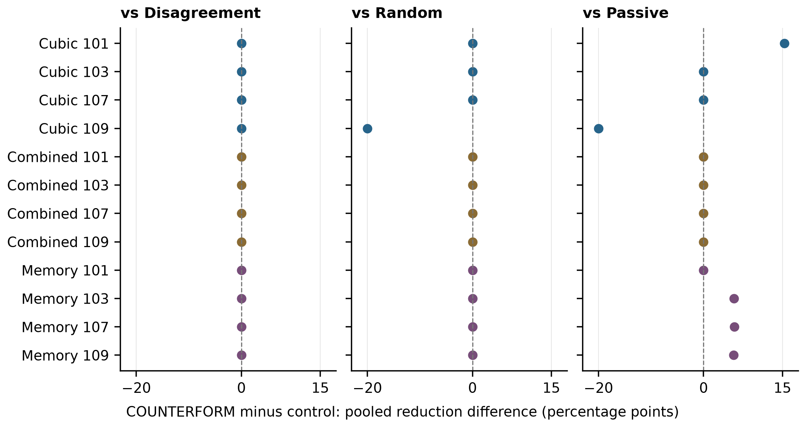
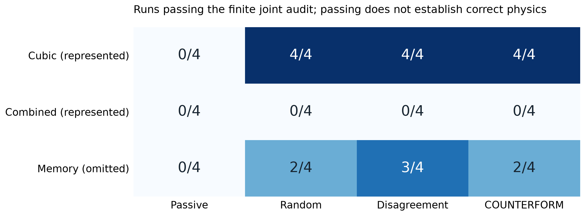

# COUNTERFORM v0.2: Distinct Experiments, Unchanged Designs in a Decision-Risk Development Study

**kai9987kai**

3 November 2026

Development research report. This paper accompanies the preserved v0.1 pilot; it is not a peer-reviewed or confirmatory study.

## Abstract

An experiment can change a fitted model without changing a useful design decision. COUNTERFORM v0.2 makes this distinction inspectable in a finite synthetic oscillator laboratory. The revised protocol fits eight instantaneous physical-law compositions, constructs 24 deterministic sensitivity particles, and selects a tuned mass absorber from a common 30-design grid. Its COUNTERFORM acquisition rule estimates one-step generating-particle loss after the actual downstream CVaR/mean decision rule; a predictive-disagreement control uses the same particles. A separate joint audit requires one frozen fitted law to pass force-balance and free-running trajectory checks. We evaluate 48 development runs crossing four seeds, three worlds and four acquisition strategies. COUNTERFORM and disagreement acquire different experiment sequences in all 12 matched world-seed cases, yet select identical absorbers and produce identical candidate-design challenge RMS outcomes in every pair. Mean paired pooled-reduction differences are 0.00 percentage points against disagreement, -1.66 against random, and 1.06 against passive acquisition. Across 144 challenge conditions, 28 worsen displacement despite positive mean pooled reductions. The audit passes 19 runs and abstains in 29; it rejects every represented combined-law run while accepting seven of 16 omitted-memory runs. Thus the revised selector changes experiments without demonstrating design-performance gain, and the stricter diagnostic remains fallible. Complete records, numerical methods and negative outcomes are retained. These results concern a small instrumented synthetic system and establish neither general acquisition efficacy nor physical reliability.

**Keywords** Decision-focused experiment design; model adequacy; sensitivity particles; tuned mass absorbers; negative results; reproducible research

## 1 Introduction

Automated experimentation connects at least three different outcomes: changing knowledge about a system, changing a downstream decision, and improving the decision's measured performance. A difference at one stage does not establish a difference at the next. Model criticism adds a separate requirement: a useful-looking design can arise from an inadequate model, while a represented law can be poorly identified from limited noisy measurements.

The original COUNTERFORM pilot joined finite-family oscillator fitting, experiment selection and conceptual absorber design [1]. Its decision-weighted heuristic coincided with predictive disagreement, while a residual audit accepted some structurally incomplete models. Version 0.2 changes acquisition, expands the finite law library, adds sensitivity particles and a fixed physical grid, and introduces a joint audit with abstention. It defines a new protocol; the first paper and evidence remain unchanged.

We ask whether the revised selector produces different experiments and better selected-design outcomes than three controls, and whether the audit distinguishes represented dynamics from omitted memory. The contribution is an inspectable finite comparison, not unrestricted equation discovery or autonomous mechanical invention.

All 12 COUNTERFORM/disagreement pairs use different experiment sequences but choose the same absorber with equal challenge performance. Increased library coverage and forecasts also fail to yield a calibrated detector of missing physics.

## 2 Relation to prior work

Goal-driven experimental design already connects acquisition with downstream robust decisions. GoBOED uses approximate posterior inference and a differentiable decision layer [2]. COUNTERFORM instead enumerates particles and a finite grid, with heuristic likelihoods, weights and updates. It does not reproduce GoBOED or inherit its theoretical results.

Model misspecification is likewise established prior work. Catanach and Das study design criteria for robustness to, and detection of, discrepancy, including a spring-mass-damper example [3]. Neither the mechanical setting nor discrepancy-aware acquisition is novel here. We implement recorded finite controls and an omitted relaxation state.

The law compositions and absorber parameters are predetermined. Fitting and enumeration are restricted calculations; their value here rests on measured comparisons and disclosed failures.

## 3 Computational methods

### 3.1 Hidden systems and observations

The primary mass is known and fixed at 1 kg. The instantaneous restoring force is `k x + c v + alpha x^3 + f tanh(v/0.04) + q |v| v`. For each seed, stiffness is uniform on 33-39 N/m and viscous damping on 0.26-0.40 N s/m. The cubic coefficient, when present, is uniform on 180-260 N/m^3. The cubic world has no friction or drag. The combined world adds friction 0.70 N and quadratic drag 3.2 N s^2/m^2. Its retained identifier, `unmodelled`, is historical: all three terms are represented jointly in the v0.2 library.

The memory world uses a linear primary system plus hidden force z, satisfying `0.22 dz/dt + z = 4.5 v`, with time constant 0.22 s and velocity gain 4.5 N s/m. No instantaneous candidate contains this state. World variants share primary stiffness and damping for a seed and are therefore related instances.

Each trial starts from rest, applies `A sin(omega t)`, and runs for 14 s with 421 samples. Independent Gaussian perturbations have standard deviations `0.1 sigma` m for position, `0.75 sigma` m/s for velocity, `4 sigma` m/s^2 for acceleration, and `max(A,0.25) sigma` N for force; sigma is 0.01. Streams indexed by seed and sequence reuse channel draws across strategies, with amplitude-dependent force scaling. The learner receives these measured channels and time, not hidden coefficients or the relaxation state. Acceleration and force are directly instrumented.

### 3.2 Eight fitted laws and 24 sensitivity particles

All eight subsets of cubic stiffness, smooth friction and quadratic drag supplement linear stiffness and damping. Bounded, column-normalised least squares fits the measured force balance `F - m a`. Bounds are 5-80 N/m for stiffness, 0.015-5 N s/m for damping, 0-1500 N/m^3 for cubic stiffness, 0-3 N for friction, and 0-8 N s^2/m^2 for drag. These numerical bounds are declared conventions.

Each family supplies its point fit and two opposite target-perturbation refits. Perturbations alternate sign in 21-sample blocks with magnitude `max(abs(base residual),0.25 sigma)`, giving 24 particles. Coefficient ranges express this chosen sensitivity, not posterior coverage.

Family scores use `n_eff log(MSE) + p log(n_eff)`: `n_eff = 20 times trial count`, MSE is floored at `1e-16`, and p counts fitted coefficients. Exponentiating minus half the score difference gives relative family weights. Each family-h particle receives `(0.95 w_h + 0.05/8)/3`, retaining 5% exploration mass. These are uncalibrated conventions; noisy regressors and targets receive no errors-in-variables correction.

### 3.3 Common design space and downstream rule

The physical grid is identical across seeds, worlds, strategies and hypothetical updates. It combines absorber masses 0.08 and 0.16 kg, tuning ratios 0.75, 0.9, 1, 1.1 and 1.25 relative to 6 rad/s, and damping ratios 0.05, 0.15 and 0.3. Stiffness and damping follow `k_a = m_a (6 r)^2` and `c_a = 2 zeta m_a 6 r`. This gives 30 fixed SI designs, rather than a grid whose physical parameters move with a fitted resonance.

For every particle and design, the training loss is mean squared approximate peak displacement over 39 uniformly weighted forcing pairs, divided by that particle's no-absorber mean squared displacement. Frequencies are 3-9 rad/s in steps of 0.5, with amplitudes 0.75, 1.5 and 2 N. The design minimises `0.7 CVaR_upper20%(loss) + 0.3 mean(loss)` over particle weights. Fractional atoms at the upper-tail boundary are included, and ties select the first grid entry. A nominal control separately minimises loss for the highest-relative-weight family point fit.

The response surrogate solves a describing-function balance, derives equivalent stiffness and damping from the no-absorber orbit, and reuses them under absorber coupling. Polynomial cases isolate roots using numerically computed analytic/quartic stationary points. Smooth-friction cases sample the analytic derivative at 129 points and refine possible extrema by bounded minimisation. Their first-root isolation has no global branch guarantee. The response bound is 128 m and root absolute tolerance is `1e-13` m. Even a well-resolved scalar root does not validate baseline-orbit reuse, coupled nonlinear branches, jumps or hysteresis.

### 3.4 Acquisition and its approximation boundary

Every arm begins at 3.4 rad/s and 0.35 N. The passive arm then follows `omega_i = 3.4 + 0.13 i` at 0.35 N for zero-based trial index i. Other arms choose unused pairs from frequencies 3.5, 4.6, 5.7, 6.8 and 8 rad/s and amplitudes 0.45, 1 and 1.8 N. Random acquisition samples the remaining menu uniformly. Disagreement maximises weighted variance of the particles' predicted no-absorber peak displacement.

For COUNTERFORM, each menu pair defines a Gaussian likelihood around each particle's peak prediction. Its common scale is `max(0.05 weighted predicted peak,0.1 sigma,0.002 m)`. Each of 24 generating particles supplies three hypothetical observations at minus, zero and plus `sqrt(3)` likelihood scales, weighted 1/6, 2/3 and 1/6. For each of these 72 fantasies, likelihood reweighting updates the frozen particles and the actual CVaR/mean rule selects a hypothetical design. That design's loss under the generating particle is averaged over generators and quadrature outcomes. The acquisition score is current generating-particle expected loss minus this hypothetical expected loss.

Selection follows the risk-sensitive rule, but acquisition evaluates generating-particle mean loss. Negative scores are retained; nonnegative Bayesian value of information is not guaranteed. Fantasies only reweight particles, whereas actual acquisitions refit coefficients from all measured channels. This mismatch makes the calculation an approximate one-step decision-risk surrogate. A planted nuisance-versus-decision test establishes possible policy differences, not empirical benefit.

Records retain every menu score, scale, risk and selected identity, distinguishing warmup/passive schedules from menu selections. All arms compute the same post-warmup diagnostics; equal trial counts do not equalise forcing energy or computation.

### 3.5 Joint audit and abstention

After acquisition, coefficients, particles, selected absorber and nominal control freeze. Two independent audit trials use frequency/amplitude pairs (4.85 rad/s, 2.3 N) and (7.85 rad/s, 0.9 N), outside the acquisition menu. Each family point fit receives a force-balance residual check and a free-running position forecast from known rest and commanded forcing. Measured audit states do not enter the forecast.

Force NRMSE divides residual RMS by the larger of measured force-balance RMS and 0.1 N. Forecast NRMSE divides position-error RMS by the larger of measured position RMS and 0.02 m. Every trial must meet both thresholds for the same fitted family. Thresholds are `0.08 + 2 sigma` and `0.15 + 3 sigma`, or 0.10 and 0.18 here. Integration failure fails forecast support. These fixed engineering diagnostics have no calibrated error guarantee.

A conditional absorber recommendation requires at least one jointly adequate family and a pre-challenge selected objective below the no-absorber reference of 1. Otherwise the run abstains and uses no absorber in its recommendation comparison. The exploratory absorber and its measured outcomes remain recorded. Recommendation freezes before challenge evaluation; held-out success cannot promote a failed audit.

## 4 Frozen development protocol and evaluation

The saved plan crosses four seeds (101, 103, 107, 109), three worlds and four strategies: 48 cases at budget 4 and noise 0.01. Plan and Python source froze before execution. This is development, not externally preregistered confirmation. All cases completed; none was dropped or retried.

Each run evaluates shifted-frequency forcing (5.15 rad/s, 1.25 N), high load (6.55 rad/s, 2.1 N), and component tolerance (7.45 rad/s, 1.6 N). Secondary-tone amplitudes are 0.12, 0.22 and 0.17 times the primary tone; the secondary frequency is 1.73 times the primary, with phase 0.37 rad. This tone is not an integer harmonic despite retained challenge labels. The third condition multiplies absorber mass, stiffness and damping by 1.08, 0.85 and 0.8. Selected, nominal and grid controls share these settings.

Evaluation uses the 7-14 s RMS window, which includes transient effects. Within-run pooled reduction is `100 (1 - sqrt(sum selected_RMS^2 / sum baseline_RMS^2))`; worst reduction is the minimum condition percentage. Table means then average run-level values over four seeds. These quantities describe the exploratory candidate, including abstentions, rather than an operational policy that installs every candidate.

The illustrative constraints limit sampled primary displacement peaks to 0.5 m and sampled absorber stroke peaks to 0.65 m, using only output times within the 7-14 s evaluation window. These are not continuous peak checks or bounds on the initial 0-7 s trajectory. A common retrospective oracle chooses one design feasible under these sampled checks across all conditions; a no-absorber control is eligible only if its sampled primary peak also satisfies every limit. If none is eligible, the record reports no feasible control and null oracle metrics. Separate unconstrained per-condition optima remain diagnostics, not acquisition strategies.

Nonlinear simulation uses DOP853 with relative/absolute tolerances `2e-8`/`2e-10` and maximum step 0.08 s. Independent Radau comparisons cover only the first condition's baseline and selected displacement trajectories, two checks per run. They do not validate all designs, challenges or physical dynamics. Paired differences below use COUNTERFORM minus the control for each matched world/seed; no inferential significance claim is made.

## 5 Results

### 5.1 Distinct experiments do not change the design

COUNTERFORM and disagreement select different complete acquisition sequences in all 12 matched cases. Nevertheless, they select the same physical grid entry in all 12, and every candidate challenge RMS and pooled/worst reduction agrees. Thus their mean paired pooled-reduction difference is exactly zero in the saved numerical results, not merely equal after rounding. This distinguishes v0.2 from the earlier policy-coincidence pilot without establishing an engineering performance gain.

Table 1 reports every world/strategy cell. All values describe candidate designs. No selected design violates the two declared illustrative limits, but 28 of 144 condition evaluations increase displacement RMS. Positive pooled reduction can therefore conceal an adverse forcing condition.

**Table 1. Candidate-design results.** Each cell has four seeds and 12 challenge conditions. Reduction columns are arithmetic means of run-level pooled and worst-condition percentages. Audit and abstention counts are separate from candidate performance; negative counts retain all adverse conditions.

| World | Strategy | Pooled % | Worst % | Audit / 4 | Abstain / 4 | Negative / 12 |
|---|---|---:|---:|---:|---:|---:|
| Cubic | Passive | 31.65 | -19.40 | 0 | 4 | 3 |
| Cubic | Random | 35.49 | -26.60 | 4 | 0 | 4 |
| Cubic | Disagreement | 30.50 | -23.91 | 4 | 0 | 4 |
| Cubic | COUNTERFORM | 30.50 | -23.91 | 4 | 0 | 4 |
| Combined | Passive | 29.50 | 3.03 | 0 | 4 | 0 |
| Combined | Random | 29.50 | 3.03 | 0 | 4 | 0 |
| Combined | Disagreement | 29.50 | 3.03 | 0 | 4 | 0 |
| Combined | COUNTERFORM | 29.50 | 3.03 | 0 | 4 | 0 |
| Memory | Passive | 34.77 | 6.70 | 0 | 4 | 1 |
| Memory | Random | 39.11 | -13.60 | 2 | 2 | 4 |
| Memory | Disagreement | 39.11 | -13.60 | 3 | 1 | 4 |
| Memory | COUNTERFORM | 39.11 | -13.60 | 2 | 2 | 4 |

Table 2 and Figure 1 show the paired comparisons. Against random acquisition, the mean difference is -1.66 percentage points. It arises from one cubic case, seed 109; the other 11 pairs have equal candidate outcomes. Against passive acquisition, a mean difference of 1.06 points combines positive and negative pairs. Neither small descriptive comparison supports a general advantage. The fixed grid often maps different acquired fits to the same design, but the study does not isolate the cause of each coincidence.

**Table 2. Paired pooled-reduction differences in percentage points.** There are 12 matched world/seed pairs per row. Same-design and same-sequence counts compare COUNTERFORM with the listed control. Higher reduction differences favour COUNTERFORM on the pooled metric only.

| Control | Mean | Minimum | Maximum | Same design / 12 | Same sequence / 12 |
|---|---:|---:|---:|---:|---:|
| Disagreement | 0.00 | 0.00 | 0.00 | 12 | 0 |
| Random | -1.66 | -19.97 | 0.00 | 11 | 0 |
| Passive | 1.06 | -19.97 | 15.36 | 7 | 0 |



**Figure 1. Paired candidate-design differences.** COUNTERFORM minus each control in run-level pooled RMS reduction, in percentage points, for all 12 world/seed pairs. Zero denotes equal candidate performance, not equal experiments or identical recommendation outcomes. The plotted data are the 36 rows of `runs/v02-development-20261103/paired.csv`; no pair is omitted.

### 5.2 Audit support does not identify structural coverage

Nineteen runs pass the joint audit and 29 abstain. All 16 combined-world runs fail even though the library now includes the complete cubic/friction/drag composition. All four passive cubic runs also fail. These observations show that a represented family does not ensure an adequate acquired fit under this noise, fitting procedure and excitation budget.

Conversely, seven of the 16 omitted-memory runs pass: random and COUNTERFORM at seeds 101 and 107, and disagreement at seeds 101, 107 and 109. Figure 2 displays the audit counts. An instantaneous fit can pass the finite checks despite omission of the hidden state. The acceptance count is a demonstrated limitation of this protocol, not an estimate of a calibrated detector's false-acceptance rate over a defined population.

At memory seed 109, disagreement and COUNTERFORM select the same absorber and have equal candidate performance, but only disagreement passes the audit. Their recommendation decisions consequently differ. Candidate-design equality must not be expanded into a claim that the complete decision procedures are equivalent. The maximum independent solver discrepancy is `3.5791e-8` over the stated limited trajectory checks; this numerical agreement does not resolve model misspecification.



**Figure 2. Joint-audit outcomes.** Passing and failing run counts by world and acquisition strategy, with four seeds per cell. Both force and forecast criteria must pass on every audit trial for the same frozen family. The memory mechanism is outside the candidate library, so its seven passing runs illustrate the diagnostic's structural-discrimination limit. These counts do not measure physical safety or population-level reliability.

## 6 Interpretation and limitations

Distinct acquisition policies do not establish useful decision value, and joint checks do not establish structural truth. Relative weights, library coverage, audit support and measured candidate performance must remain separately inspectable.

Equal designs could reflect grid coarseness, similar particle losses, weak likelihood information or a poor approximation to refitting; this study does not isolate their causes. Tuning the grid, weights or thresholds on these outcomes would not constitute confirmation.

Only four parameter seeds are used; related variants and within-run conditions are not independent replicates. Worlds are hand specified, mass is known, and sensors supply acceleration and force. Regression bias and particle calibration remain unresolved. The likelihood compresses trajectories to approximate peaks, while actual learning consumes all measured channels.

The describing-function surrogate may miss coupled branch changes, hysteresis and transients; friction root isolation has no global guarantee. Grids, challenges, bounds and windows are finite, and solver checks cover only two trajectories per run. Low discrepancy does not check physical truth. The no-absorber fallback and conceptual CAD establish neither safety nor manufacturing, fatigue or stability qualification.

No quantitative v0.1-to-v0.2 improvement is claimed: model, acquisition and design protocols changed. This study provides neither independent replication nor peer review.

## 7 Evidence and reproducibility

The repository retains the plan, 48 receipts/reports/ZIPs, complete CSV, 36 paired rows and summary. All serialized receipts and ZIPs verified, and one recorded v0.2 receipt reproduced its numerical and source hashes locally. Checksums do not authenticate authorship or validate physics; exact floating-point equality depends on platform, libraries and execution environment. Matching operating-system and package versions alone do not fix CPU-dispatched BLAS behaviour or guarantee a bitwise match.

The study used Python 3.12.10, NumPy 2.4.3 and SciPy 1.17.1. Its plan SHA-256 is `a6ec7a0e6118f56535b3242fd321cd54baa3060ff725edd07b24967424e892cf`; its recursive scientific-package Python source SHA-256 is `c6111b4f22b3919f1a15cecc35a97406dc93720b0ba7d4ca01f3129e91f5db59`. The original pilot engine, paper and publication artifacts are preserved under an 82-artifact manifest. Separate version dispatch prevents an old receipt from silently using the new numerical protocol.

Before study execution, local validation passed 152 Python tests, 11 frontend checks and the production build. A wheel built from a committed snapshot subsequently ran independently with the frozen study source hash. These are software checks, not empirical support for the acquisition method. The numerical environment is listed in `requirements-validated.txt`. From the repository root, use a new output directory to repeat the fixed study:

```powershell
python -m pip install -r requirements-validated.txt
python -m pip install -e ".[dev]"
python -m counterform.studies docs/protocols/v02-development.json --output runs/v02-development-replay
python -m counterform verify runs/v02-development-20261103/memory/101/counterform/evidence.zip
python -m counterform replay runs/v02-development-20261103/memory/101/counterform/receipt.json
```

Data and code: https://github.com/kai9987kai/COUNTERFORM/tree/codex/counterform-v02. The exact study files are under `runs/v02-development-20261103`; the protocol explanation and complete results are `docs/research-v02.md` and `docs/v02-results.md`. The preserved pilot PDF and source archive remain under `publications` [1].

## 8 Conclusion

COUNTERFORM v0.2 makes a finite decision-risk calculation and joint audit inspectable. Its 48-run study shows no design-performance gain over disagreement: all 12 paired acquisitions differ, but selected absorbers and candidate-design challenge RMS outcomes coincide. Recommendation outcomes can differ. Rejecting every combined-law run while accepting seven omitted-memory runs exposes unresolved identification and discrimination limits. Retaining these distinctions, adverse conditions and abstentions is the study's principal outcome. Broader claims require independently chosen tests and evidence beyond this synthetic laboratory.

## References

[1] kai9987kai. COUNTERFORM A Synthetic Pilot Study of Experiment Selection and Model Adequacy. Development research report, 2 November 2026. Preserved original paper: https://github.com/kai9987kai/COUNTERFORM/blob/2878441b7a6e792e19e02650e88cd20a37d025c8/publications/counterform_pilot_paper.pdf.

[2] Go, J., Qian, X., and Yoon, B.-J. Goal-driven Bayesian Optimal Experimental Design for Robust Decision-Making Under Model Uncertainty. arXiv:2605.26093, version 1, 25 May 2026. https://doi.org/10.48550/arXiv.2605.26093.

[3] Catanach, T. A., and Das, N. Metrics for Bayesian Optimal Experiment Design under Model Misspecification. arXiv:2304.07949, version 1, 17 April 2023. https://doi.org/10.48550/arXiv.2304.07949.
